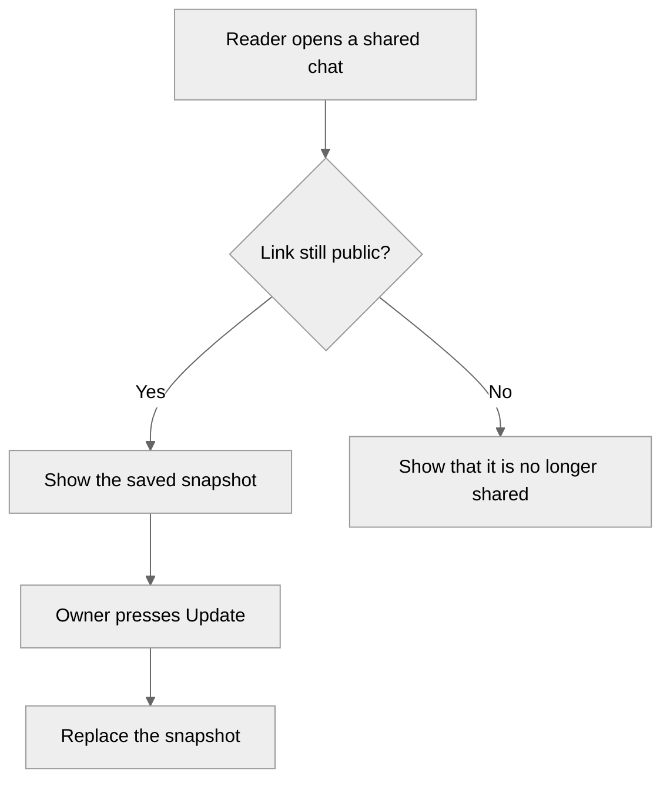

# PR review

Review the current PR or branch against main.

## Gather
1. `gh pr view --json number,title,headRefName,baseRefName,url` for the current branch. No PR → review the branch against main.
2. Read the diff and enough of the surrounding code to judge it.
3. Check the PR head in a separate git worktree (and a separate build/target dir), so the main checkout stays untouched. Never push, merge or change the repo.

## Check before you score
Do every check you'd otherwise list as a confidence bump, and state its result in the review:
- Run the project's tests, build, typecheck, lint and fmt check.
- UI or TUI change: run the app and capture a screenshot or recording (see `pr-media`). Behavior change: exercise the changed path (a VM, a temp config, a scratch dir).
- Try the failure and edge paths the review would otherwise ask about.

Score confidence after the checks, not before.

## Write
Body in this order, short and plain:

```
<!-- pr-review -->
`head-branch` → `base-branch`
Model: <model id>, <thinking effort, or "effort unknown">

## Confidence: X/5
<one line on why>
**Checks run:** what you ran and the result (e.g. "cargo test: 212 passed", "White theme screenshot below").
**Confidence bumps:** only what you truly can't do yourself (real hardware, another OS, secrets, production data), each with why and what it would raise the score to (e.g. "run the migration on staging (no staging access) → 4.5/5"). Otherwise "none left".

## Summary
<small description, ready to read as a PR comment>

<Mermaid flowchart of what the change does, in an open details block; see "The diagram" below>

**Where to start:** the 2-4 files to read first, one line each.

## Regressions
## Migrations
<needed or not, and what>
## Before merging
- [ ] checklist
```

## The diagram
It shows what the change does, as it happens, and is read by someone who hasn't opened the diff.
- Nodes are user actions, events, decisions and outcomes in plain words: "Reader opens a shared chat", "Link still public?", "Show the saved snapshot". Never files, modules, functions or tables.
- 6 to 14 nodes. `flowchart TD`, or `LR` for a short straight path. Decisions are `{...}` nodes with labelled edges, and the branches that changed (errors, permissions, empty states, retries) are drawn.
- Start the block with `%%{init: {'theme': 'neutral'}}%%` and wrap it in an open `<details>` block, as below.
- Backend or refactor changes: draw the request or job the change affects, from trigger to outcome, still without file names.
- No flow to draw (docs, config, dependency bump)? Leave the diagram out and write "No flow to draw: <why>" in one line.
- The files to read first go in "Where to start", not in the diagram.

Format, in the comment (an example for a change that adds shared-chat snapshots):

````
<details open><summary><h3>Diagram</h3></summary>


</details>
````

## Post
- **On a PR, with write access:** post it as a comment. Keep one review comment per author: if one exists, update it.
  ```
  me=$(gh api user --jq .login)
  id=$(gh api "repos/{owner}/{repo}/issues/<n>/comments" --paginate \
    --jq ".[] | select(.user.login==\"$me\" and (.body|startswith(\"<!-- pr-review -->\"))) | .id" | tail -1)
  [ -n "$id" ] && gh api -X PATCH "repos/{owner}/{repo}/issues/comments/$id" -F body=@review.md \
               || gh pr comment <n> --body-file review.md
  ```
  Use the GitHub account the repo's own rules say.
- **No PR, or no write access:** write it to `PR_REVIEW_{TIMESTAMP}.md` in the repo root instead, and say where it is.
